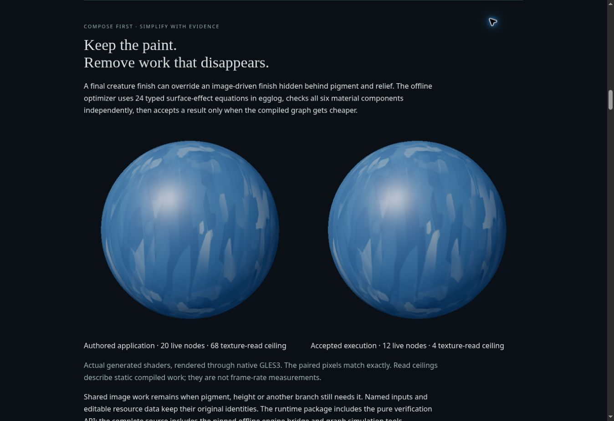

# Moonweave 57 verification

Release **0.57.0** adds a real offline egglog path, a closed typed surface-effect
algebra, an independent symbolic verifier and finite graph simulations. Graph-v1
continues to have six sorts and 25 operations. The default compiler and renderer
implementations are unchanged. The optional `/optimize` package entry adds the
checked interchange without loading the search engine into a host application.

Baseline: **0.56.0**, immutable source commit
`84fb8ca1406085fb42f6ad666e31fb91e16addf7`. npm dependency maps are unchanged;
package-lock changes only the project version. The optional Python tooling pins
`egglog==14.0.0`. It is installed separately and does not enter the npm package.
The earlier filtering release evidence remains in [VERIFICATION-56.md](../0.56/VERIFICATION-56.md).

## Functional, type and engine checks

**427 JavaScript tests passed, zero failures, zero skips.** [tests57.tap](tests57.tap)
records the completed run. Strict application and public API type checks pass.
Six separate Python tests run the real native egglog engine and pass, covering
actual saturation, typed boundaries, shared DAG costs, bounded-stop receipts,
source identities and deterministic extraction across fresh processes.

| Boundary | Verified behavior |
| --- | --- |
| Laws | All 24 closed typed equations; independent symbolic observations; 256 seeded float32 contexts per equation |
| Floating-point scope | Counterexamples exclude reassociation, tiny double complements, filtered products and reordering dependent surface effects |
| Editable identities | Equal current values stay independent; resource and domain edits retain source IDs |
| Shared consumers | A sampler survives if another pigment, height or mixed branch still uses it |
| Cost gate | Equivalent candidates that duplicate shared work are rejected; equal cost retains the exact original graph object |
| Reification | Original definitions remain addressable; repeated application does not grow the graph; source document limits are respected |
| File workflow | Actual CLI output matches the accepted fixture; fixed artifact names cannot overwrite source or output graph paths |
| Installed package | Four public entries, shared ownership/caches, standalone types, no required renderer or UI peers for core/optimization |

## Actual compiled improvements

[data/optimization57.json](data/optimization57.json) contains the source hashes,
engine receipts, compiled costs, edit scenarios and finite observations.

| Workload | Live nodes | Texture-read ceiling | Uniform components | GLSL bytes | Decision |
| --- | --- | --- | --- | --- | --- |
| Independent anisotropic finish overridden after coat/bump | 20 → 12 | 68 → 4 | 66 → 37 | 15,115 → 8,979 | Accept |
| Atlas still used by pigment/height | 20 → 14 | 68 → 68 | 62 → 60 | 13,289 → 12,958 | Accept |
| Shared module still used by a mixed branch | 25 → 25 | 68 → 68 | 71 → 71 | 15,510 → 15,510 | Retain original |

All three searches saturated in four rounds. Engine proxy extraction cost is
separate from the production compiler's cost vector. A read ceiling reduction
is a reduction in static compiled work, not a frame-rate measurement.

All **15 existing gallery examples** retain exact normalized graph JSON,
compiled nodes, program keys and generated GLSL against the baseline checkout.
No optimization benefit is claimed for these already compact examples.

Simulation covers **45 contexts × five independent edit scenarios** for each
workload: 675 final material-output comparisons and 2,925 retained named-view
comparisons. All **28,350 numeric components match exactly**. Field evaluation
uses the production CPU calculus. Surface-record observations use explicitly
supplied opaque paint leaves; they do not evaluate facets, lighting or GPU
rounding, and a finite pass is not a universal equivalence proof.

## Native generated shaders

[data/optimization57-native-sphere.json](data/optimization57-native-sphere.json)
and [data/optimization57-native-shell.json](data/optimization57-native-shell.json)
record actual Three r140/r187 physical shader assemblies run through surfaceless
EGL / GLES3, Mesa llvmpipe LLVM 20.1.2. All **46 source fingerprints** in each
report match this release's implementation and native tools.

| Check | Completed result |
| --- | --- |
| Program compilation/linking | 153 per specimen, 306 total links |
| Rendered images | 70 per specimen, 140 total |
| Optimization pairs | Three workloads × near/far × sphere/shell = 12 comparisons |
| Exact paired pixels | All 12 RGBA byte-identical; zero differing pixels |
| Nonfinite shader pixels / GL errors | Zero / zero |
| Resource parity | 647 contexts / 1,941 value and partial components per run |
| Resource maximum absolute error | 7.683398703939304e-7, within the unchanged 3e-6 gate |
| Existing native cases | All 58 names and complete recorded render statistics match the v56 receipts per specimen |

The two specimen runs reuse numerical contexts; their parity counts do not
constitute twice the independent coverage. Historical v56 receipts contain no
pixel digests, so this release makes no new byte-identity claim for all historical
images. The 12 current optimization pair comparisons do include RGBA hashes.
This is native software-driver validation, not hardware frame-rate or browser
WebGL validation.

## Browser verification

[browser57.json](browser57.json) records the actual preview checks. The new guide
shows both native before/after images and the current package links. Importing
the optimized graph through the normal file chooser succeeds; its inspector
reports 12 live nodes, 37 uniform components and four texture reads. Editing
`creatureRoughness` to 0.82 preserves the compiled costs and retained named
resource. Undo restores the original eight-node Directional finish composition.

The cloud browser cannot obtain a WebGL2 context. The atelier reports that
specific failure and labels its reference image explicitly. No live browser
frames or live-preview performance are claimed. Its download transport reported
failure after the app initiated export, and its clipboard API fell back to source
selection. Those transports are unverified here; graph serialization and the
actual offline file workflow pass separately.

## Package and source checks

The actual installable TGZ passes an isolated consumer check with **43 files**,
four public exports and standalone strict NodeNext declarations. Core and
optimization work without Three, Solid or Effect installed; a second consumer
phase verifies the injected Three adapter and ownership behavior.

[bundle57.json](bundle57.json) compares the old and new atelier JavaScript using
the same production build. The bundle remains **850,433 bytes** and **239,362
bytes gzip at level 9**. Optional optimization modules are rejected by the build
if they enter an ordinary core, renderer or combined entry. The `/optimize`
module adds 13,870 bytes to a consumer already using its shared graph/compiler
chunk; the Python engine stays offline.

[package57.json](package57.json) records the exact runtime payload, source
membership and isolated source rebuild. npm TGZ and portable ZIP contain the
same files and bytes. The complete source ZIP includes the effect manifest,
verifier, native egglog runner, simulation tools, declarations and reproducible
fixtures. The package remains private and installable locally; it has not been
published to the npm registry.
